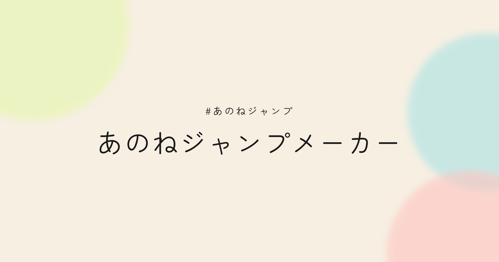

# あのねジャンプメーカー

写真を置くと、テンプレのジャンプに合わせて入れ替わる動画が作れるメーカーです。太い線とベタ塗りの、少し昔の電子ポップのような画面です。ファンによる非公式の作品です。写真はこの端末の中だけで重ね、サーバーには送りません。

[https://anone.yoiailabs.com](https://anone.yoiailabs.com)



## 機能

- 選んだ写真を、テンプレの拍に合わせて差し替える。枚数が足りなければ同じ順で繰り返す
- 向き（縦 9:16 / 横 16:9）、エフェクト（ジャンプ / ズーム）、フィルター（なし / ブラー弱 / ブラー強）、線画の大きさ（標準 / 1.2 / 1.4）
- テンプレのベタ塗り背景を抜いて、線画のキャラを残す
- ブラウザ上でプレビューし、MP4 または WebM を端末内で保存する
- `#あのねジャンプ` と `#あのねジャンプメーカー` を共有、またはコピーする
- 日本語・英語・韓国語・中国語（利用規約とプライバシーポリシーは日本語）

操作の流れと共有の挙動は [docs/usage.md](docs/usage.md) にまとめています。

## 対応ブラウザ

Chrome、Safari、Edge を優先しています。動画の保存には WebCodecs の `VideoEncoder` が必要です。使えないブラウザでは録画に切り替えず、Chrome または Edge で開くよう案内します。プレビューは Safari（iOS を含む）でも動きます。

## 技術スタック

- [Astro](https://astro.build/) の静的 HTML と、React アイランド（shadcn/ui の Base UI）
- 書き出しは WebCodecs と [mediabunny](https://github.com/Vanilagy/mediabunny)
- 背景の抜きは WebGL。未対応のときは Canvas2D
- 配信は Cloudflare Workers の静的アセット（Worker 名 `anone`）

画面の骨格は `src/pages/`、操作パネルは `src/components/MakerApp.tsx`、プレビューと書き出しは `src/app.ts` の `boot()` です。詳しくは [docs/architecture.md](docs/architecture.md)。

## 開発を始める

Node.js 22.18 以上と、pnpm 10.15.1（`package.json` の `packageManager`）が必要です。

```bash
pnpm install
pnpm exec astro dev
```

開発サーバーは [http://127.0.0.1:5173/](http://127.0.0.1:5173/) です（`astro.config.ts` のポート）。

`package.json` のスクリプトは次のとおりです。

| コマンド | 内容 |
| --- | --- |
| `pnpm exec astro dev` | 画面の開発サーバー（上記） |
| `pnpm check` | `astro check` と Worker の型チェック |
| `pnpm types` | `cf workers types` |
| `pnpm build` | 型チェックのあと `dist` を作る |
| `pnpm preview` | ビルド結果を http://127.0.0.1:4173 で見る |
| `pnpm dev` | `cf dev`。Worker の開発サーバー。`dist` が無いと起動しない |
| `pnpm dev:worker` | `pnpm build` のあと `wrangler dev` |
| `pnpm deploy` | `pnpm build` のあと `wrangler deploy` |
| `pnpm og` | OGP 画像を描き直す（Playwright の Chromium） |
| `pnpm icons` | PWA アイコンを描き直す（`CHROME_PATH` の Chrome） |

画面を直しながらの確認は `pnpm exec astro dev` です。ビルド結果や Worker を見るときは `pnpm build` してから `pnpm preview` か `pnpm dev:worker` を使います。デプロイと fork の手順は [docs/deployment.md](docs/deployment.md) です。

## テスト

```bash
pnpm test            # ユニット（Vitest / Node）
pnpm test:browser    # Chromium と WebKit（Vitest Browser）
pnpm test:e2e        # Playwright
pnpm test:all        # 上の 3 つ
```

ブラウザテストの初回は `pnpm exec playwright install --with-deps chromium webkit` が必要です。中身と CI の回し方は [docs/testing.md](docs/testing.md) にあります。

## ドキュメント

- [使い方](docs/usage.md)
- [アーキテクチャ](docs/architecture.md)
- [デプロイとセルフホスト](docs/deployment.md)
- [計測（GA4 / Sentry）](docs/telemetry.md)
- [テスト](docs/testing.md)

## ライセンス

ソースコードの著作権は Yoiailabs にあり、このリポジトリは [MIT License](LICENSE)（Copyright (c) 2026 Yoiailabs）です。ロゴと OGP 画像（`public/brand/`、`public/og.png` とその言語版）も自作で、同じ MIT の対象です。

次の 3 ファイルだけは MIT の対象外です。楽曲「あのね」、ジャンプするキャラクターおよびその映像の著作権はナナツカゼにあり、再配布・改変・転用はできません。fork では、自分で権利を持つ素材に差し替えるか、取り除いてください。

- `public/official-assets/template/landscape.mp4`（書き出しに使うテンプレ映像。縦横ともこの 1 本）
- `public/official-assets/jump-loop.mp4`（トップページの MV）
- `public/official-assets/jump-loop-still.png`（その MV の 1 フレーム）

文言は [public/official-assets/LICENSE.md](public/official-assets/LICENSE.md) です。同じディレクトリの `template/landscape-cuts.json` は生成した拍の表で、MIT です。画面に埋め込む X の投稿は各投稿者のものです。掲載をやめてほしいときの連絡先は [NOTICE.md](NOTICE.md) にあります。

Source code is copyright Yoiailabs and released under the [MIT License](LICENSE) (Copyright (c) 2026 Yoiailabs). The three files listed above are excluded. See [public/official-assets/LICENSE.md](public/official-assets/LICENSE.md) and [NOTICE.md](NOTICE.md).

外部からの pull request は受け付けていません。脆弱性の報告は [SECURITY.md](SECURITY.md) を見てください。
