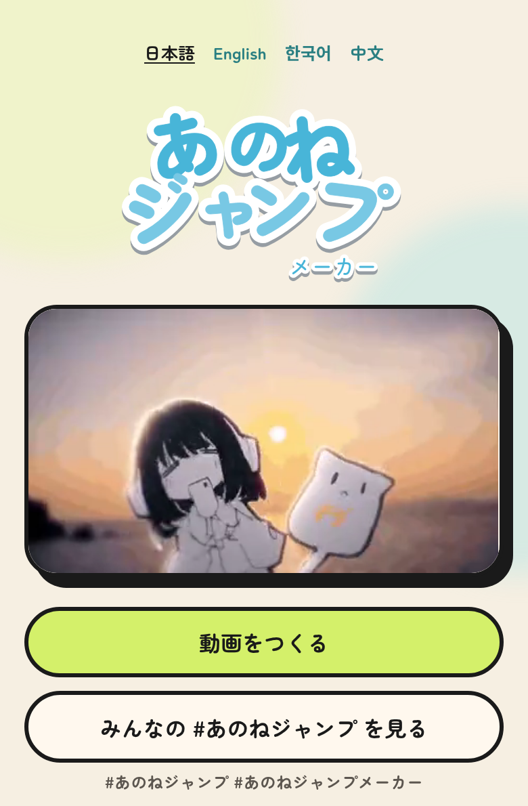
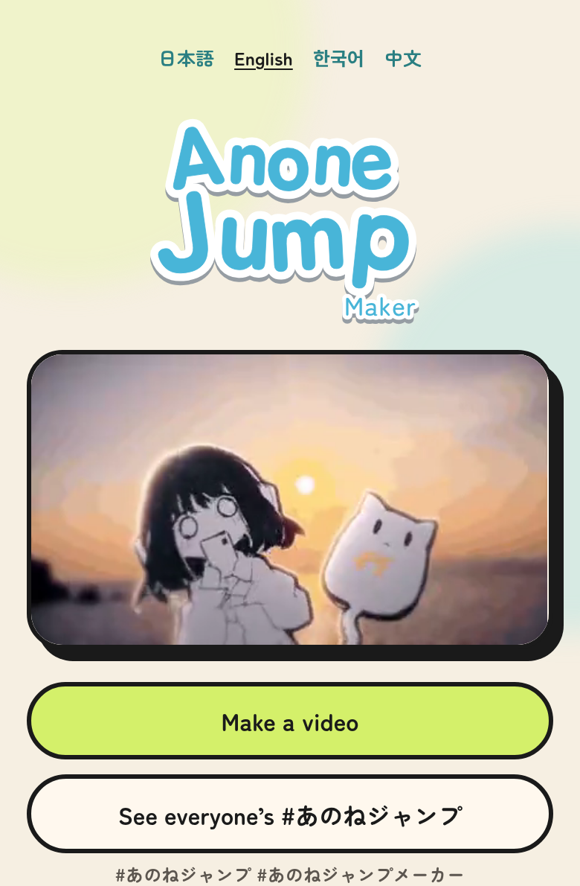
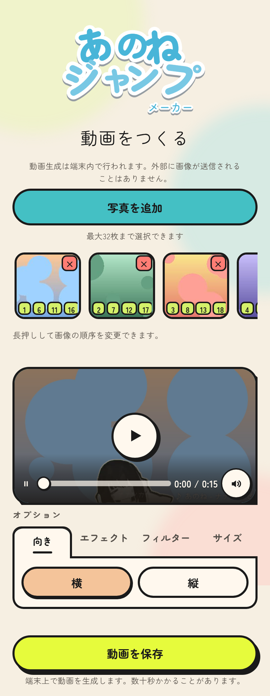
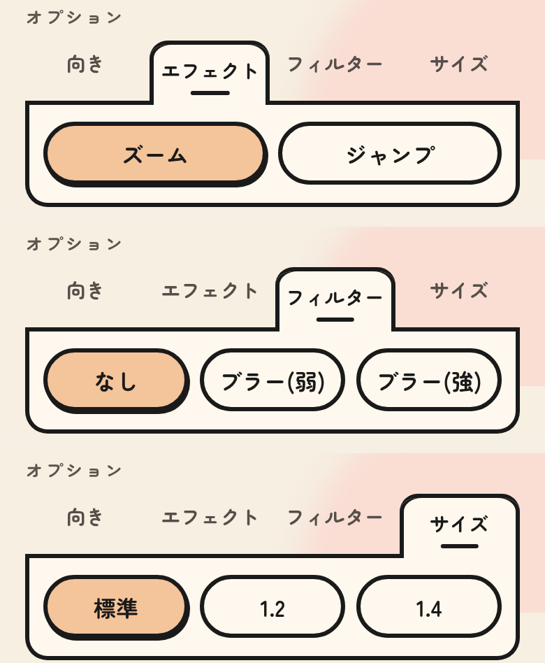

<p align="center">
  <a href="https://anone.yoiailabs.com">
    
  </a>
</p>

<p align="center">写真を選ぶだけで、キャラクターのジャンプに合わせて写真が切り替わる動画をブラウザで作れます。</p>

<p align="center">
  <a href="https://anone.yoiailabs.com">アプリを使う</a> ·
  <a href="docs/usage.md">使い方</a> ·
  <a href="docs/README.md">ドキュメント</a>
</p>

<p align="center">
  <a href="LICENSE"></a>
  <a href="https://github.com/yoiailabs/anone-jump-maker/actions/workflows/test.yml"></a>
  <a href="https://anone.yoiailabs.com"></a>
</p>

> [!NOTE]
> ナナツカゼ「あのね」の非公式ファンメイド作品です。ナナツカゼによる公認ではありません。テンプレ映像など、一部の素材は MIT の対象外です。[ライセンス](#ライセンス)を確認してください。

## 画面を見る

<table>
  <tr>
    <th>トップページ</th>
    <th>English</th>
    <th>写真を5枚入れた制作画面</th>
  </tr>
  <tr>
    <td valign="top"></td>
    <td valign="top"></td>
    <td valign="top"></td>
  </tr>
</table>

<details>
  <summary>エフェクト・フィルター・サイズの選択画面</summary>
  <p align="center"></p>
</details>

## できること

- 写真は最大32枚まで選べて、あとから追加・削除・並べ替えができます。32カットに足りない分は先頭から繰り返します。
- 動画の向きは横と縦。切り替えのエフェクト（ズーム／ジャンプ）、写真のぼかし、キャラクターの大きさも選べます。
- 音声付きでプレビューし、MP4 か WebM で保存します。対応している端末では共有シートから直接送れます。
- 画面は日本語・英語・韓国語・中国語に対応しています。利用規約とプライバシーポリシーは日本語のみです。

写真の読み込みから合成、動画の書き出しまで、すべて端末の中で処理します。選んだ写真はサーバーへ送りません。テンプレ映像の背景色を抜いて写真に重ね、切り替えのタイミングに合わせて1フレームずつ動画にしていきます。なお、サイトや素材の読み込み、X・YouTube の埋め込み、任意で有効にできる計測には通信が発生します。[処理の構成](docs/architecture.md)と[計測の内容](docs/telemetry.md)を参照してください。

## 対応ブラウザ

動画の保存には WebCodecs の `VideoEncoder` と、使える映像エンコーダーが必要です。同じブラウザでも端末によって使えるかどうかが変わるため、使えないときは画面で Chrome か Edge で開くよう案内します。プレビューだけなら Safari（iOS を含む）でも動きます。

自動テストは Chromium と WebKit で、写真の読み込みからプレビュー、保存までを確認しています。スマートフォンはエミュレーションでのテストなので、実機での動作保証や最低バージョンは決めていません。[テスト範囲](docs/testing.md)も確認してください。

## クイックスタート

Node.js 22.18.0 以上と pnpm 10.15.1 が必要です（[package.json](package.json)）。

```bash
git clone https://github.com/yoiailabs/anone-jump-maker.git
cd anone-jump-maker
pnpm install --frozen-lockfile
pnpm exec astro dev
```

[http://127.0.0.1:5173](http://127.0.0.1:5173) を開くとアプリが動きます。環境変数の設定は要りません。

### 主なスクリプト

| コマンド | 用途 |
| --- | --- |
| `pnpm check` | Astro と Worker の型チェック |
| `pnpm build` | 型チェックと静的サイトの生成。出力先は `dist/` |
| `pnpm preview` | ビルド結果を `http://127.0.0.1:4173` で確認 |
| `pnpm dev:worker` | ビルドしてから Wrangler で Worker を起動 |
| `pnpm dev` | `cf dev` で Worker を起動。先に `pnpm build` が必要 |
| `pnpm deploy` | ビルドして Cloudflare Workers へ公開 |

公開前の差し替えは[セルフホストの手順](docs/deployment.md)にまとめています。

## テスト

```bash
pnpm test
```

これでユニットテストが走ります。ブラウザテスト（`test:browser`）と E2E（`test:e2e`）の準備と実行方法は[テストのページ](docs/testing.md)にあります。

## 技術スタック

画面は Astro + React、UI は Tailwind CSS と shadcn/ui（Base UI）、写真の並べ替えは dnd-kit です。合成には Canvas 2D / WebGL、動画生成には WebCodecs / mediabunny を使い、Cloudflare Workers から静的ファイルを配信します。

## ドキュメント

| ページ | 内容 |
| --- | --- |
| [使い方](docs/usage.md) | 写真を並べてから動画を保存するまで |
| [アーキテクチャ](docs/architecture.md) | 写真の処理、合成、動画の書き出し、配信のしくみ |
| [セルフホスト](docs/deployment.md) | fork で差し替える素材と設定、Cloudflare Workers への公開 |
| [計測](docs/telemetry.md) | GA4 / Sentry の有効化と送る内容 |
| [テスト](docs/testing.md) | テストの種類と実行方法、CI |

## ライセンス

ソースコードは [MIT License](LICENSE)、Copyright (c) 2026 Yoiailabs です。自作のロゴ（`public/brand/`）と OG 画像（`public/og*.png`）も MIT に含まれます。

次の素材はナナツカゼの著作物で、MIT の対象外です。

| ファイル | 内容 |
| --- | --- |
| `public/official-assets/template/landscape.mp4` | 動画生成に使う、音声付きテンプレ映像 |
| `public/official-assets/jump-loop.mp4` | トップページの MV 映像 |
| `public/official-assets/jump-loop-still.png` | MV 映像の静止画 |

これらの再配布・改変・転用は許諾していません。fork する場合は、自分で権利を持つ素材に差し替えるか取り除いてください。詳しくは[公式素材の権利表記](public/official-assets/LICENSE.md)を参照してください。同じ場所の `template/landscape-cuts.json` は生成した拍の表で、MIT の対象です。

埋め込まれた X 投稿の権利は各投稿者にあり、MIT の対象外です。ご自身の投稿の掲載停止は、投稿 URL を添えて [GitHub Issue](https://github.com/yoiailabs/anone-jump-maker/issues) または [@aku11i](https://github.com/aku11i) へ GitHub 経由でご連絡ください。

外部からの pull request は受け付けていません。X 投稿の掲載停止の依頼は Issue で受け付けています。脆弱性の報告方法は [SECURITY.md](SECURITY.md) にあります。
