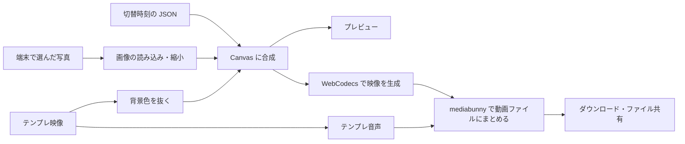

# アーキテクチャ

写真の読み込みから動画生成までをブラウザで処理し、Cloudflare Workers は静的ファイルの配信と言語別 URL の振り分けを担当します。プレビューと保存は同じ合成処理を共有します。

## 写真から保存ファイルまで

テンプレ映像と切替時刻の JSON はサイトから取得します。選んだ写真はアップロードせず、読み込み時に長辺2880pxまで縮小して保持します。サムネイルは別に作り、同時に読み込む写真を2枚までに抑えています（[photos.ts](../src/photos.ts)）。

合成はプレビューと保存で同じ `draw()` を使います。テンプレ映像の背景色を抜く処理には WebGL を優先し、使えない場合は Canvas 2D に切り替えます。写真、キャラクター、切替エフェクトを重ねる処理は [compositor.ts](../src/compositor.ts) にあります。

プレビューは出力サイズの1/3、24fpsで描画します。保存時は通常30fpsでフレームを作り、テンプレ音声と合わせて MP4 または WebM にまとめます。`VideoEncoder` や対応コーデックが使えない場合はエラーを表示し、MediaRecorder への切替はしません（[export.ts](../src/export.ts)、[offline-encode.ts](../src/offline-encode.ts)）。

## 画面と処理の分担

| 場所 | 担当 |
| --- | --- |
| [src/pages/](../src/pages/)・[Layout.astro](../src/layouts/Layout.astro) | 静的ページ、メタ情報、共通の HTML |
| [MakerApp.tsx](../src/components/MakerApp.tsx) | トップ・制作画面の UI とオプションの操作 |
| [PhotoThumbs.tsx](../src/components/PhotoThumbs.tsx) | 写真の一覧と dnd-kit による並べ替え |
| [app.ts](../src/app.ts) | `boot()` による起動、再生・生成・画面遷移の接続 |
| [layout.ts](../src/layout.ts)・[timeline.ts](../src/timeline.ts) | 出力サイズ、素材の参照先、エフェクト、写真の切替順 |
| [i18n.ts](../src/i18n.ts)・[messages.ts](../src/messages.ts) | 言語別 URL と画面の文言 |
| [worker/index.ts](../worker/index.ts) | 言語のリダイレクトと静的アセット応答の補正 |

画面の骨格は Astro、操作 UI は React です。既存の `boot()` と React はストアやコールバックで値をやり取りします。新しい操作 UI も React コンポーネントに追加します。

`/` がトップ、`/make` が制作、`/community` が投稿一覧です。英語・韓国語・中国語には `/en`・`/ko`・`/zh` が付きます。`/privacy` と `/terms` は日本語のみです。

## 配信と外部通信

Worker は保存済みの言語 Cookie に従って URL を振り分けます。`Accept-Language` での HTTP リダイレクトはせず、ブラウザの言語に応じた初回移動はクライアント側で処理します。

`/_astro/*` に存在しないファイルを要求したときは、HTML が JavaScript としてキャッシュされないよう、Worker が `no-store` の404を返します。Service Worker も HTML をキャッシュせず、動画・音声・Range リクエスト・テンプレ素材は処理対象から外します（[public/sw.js](../public/sw.js)、[public/sw-policy.js](../public/sw-policy.js)）。オフラインでサイト全体を利用できる設計ではありません。

Google Fonts、X の埋め込み、YouTube の埋め込みにも通信します。GA4 と Sentry はビルド時の設定に応じて読み込みます。送信内容は[計測](telemetry.md)、素材の差し替えは[セルフホスト](deployment.md)を参照してください。

[ドキュメント目次へ](README.md)
